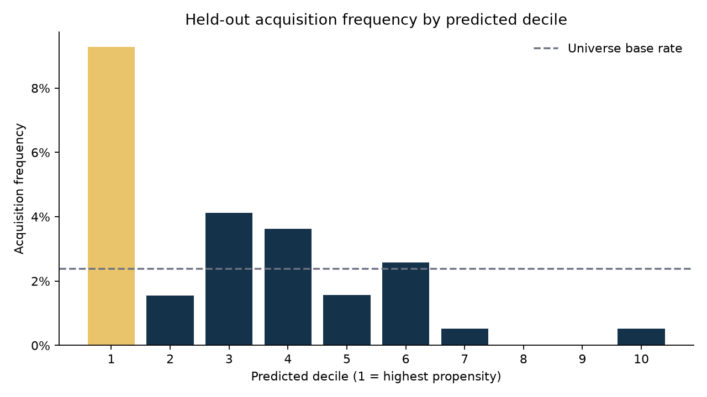

# Acquisition Probability Model

I built this project to explore a question that interests me in M&A: can a
company's financial characteristics help identify it as a possible takeover target?
I wanted to combine financial analysis with Python, SQL and machine learning.

The model ranks companies by their estimated chance of receiving a takeover
announcement within the next 12 months. I see it as a way to build a shortlist
for further research, not as a tool that can tell me which companies will
definitely be acquired.

## What I wanted to measure

Acquisitions are rare, so a model could predict "no acquisition" for almost every
company and still have high accuracy. That would not be very useful.

Instead, I look at the highest-ranked 10% of companies, also called the top decile.
I compare their acquisition rate with the rate across all companies in the sample.
This ratio is called **lift**.

In the demo, the top 10% had a 9.28% acquisition rate, compared with 2.38% across
the full sample. That gives **3.89× lift** and captures 39.1% of the positive
company-year observations.

**The demo uses generated data, not real company data.** These numbers show how
the model behaves on that example. They do not show that it can predict real
takeovers or earn investment returns.



## How to run it

You need Python 3.11 or newer. Open a terminal in the project folder and run:

```bash
python -m venv .venv
source .venv/bin/activate
python -m pip install -e '.[dev]'
acq-model demo
```

If you already have the virtual environment, activate it and run `acq-model demo`.
The demo creates its own data and saves the results in `outputs/demo/`.
You do not need to download a dataset or create `data/processed/company_panel.csv`.

To run the tests and check code style, use `pytest` and `ruff check .`.

## How it works

I use inputs such as valuation compared with industry peers, company size,
growth, ownership, cash, debt, profitability and recent stock performance. I also
include research-based inputs such as ownership changes, industry deal activity,
takeover defenses and measures of innovation.

I compare four versions: a basic logistic regression, a logistic regression with
the extra research inputs, a gradient-boosting model, and a version without the
stock-underperformance variables. The basic logistic model wins on the demo's
validation data, so that is the model used for the final test.

The main steps are:

1. Check the data and mark whether a takeover was announced in the following year.
2. Calculate the financial inputs using information available at the time.
3. Start with 2012–2017 data, then compare models on 2018 and 2019. Each model
   only learns from outcomes that would already have been known at that point.
4. Use a separate 2020 sample to adjust the scores into estimated probabilities.
5. Test the chosen model on 2021–2024 without changing it using those results.

The 2020 outcomes must be fully known before the first test prediction. Missing
optional inputs are filled using training data only. Alongside lift, I report
how many targets the shortlist captures, probability errors and an uncertainty
interval that accounts for companies appearing in several years.

More detail is in [the methodology](docs/methodology.md). I explain which papers
influenced the project in [the research notes](RESEARCH_IMPLEMENTATION.txt).

## Using your own data

The project does not download real market data. To use your own dataset, start
with [the data dictionary](docs/data_dictionary.md). You need historical company
information and takeover announcements, including companies that were later
acquired or delisted—not just companies that still trade today.

If your file already includes the acquisition labels, run:

```bash
acq-model train --input data/processed/company_panel.csv \
  --as-of 2025-12-31 --output-dir outputs/real_run
```

Use `--as-of` for the date through which your announcement records are complete.
Do not automatically use today's date. Each training observation needs a full
year of follow-up data. You can also provide this date in an
`outcomes_observed_through` column.

If you have separate company and announcement files, create the labels first:

```bash
acq-model label --input data/raw/company_snapshots.csv \
  --events data/raw/target_announcements.csv --as-of 2025-12-31 \
  --output data/processed/company_panel.csv
```

The announcement file needs `company_id` and `announcement_date`. The code removes
observations without a complete follow-up year and companies whose takeover was
already announced. Include qualifying bids even if they were later withdrawn:
the model predicts announcements, not whether a deal eventually closes.

To rank companies for a later date using the saved model:

```bash
acq-model score --input data/processed/latest_cross_section.csv \
  --model outputs/real_run/model.joblib --output outputs/latest_candidates.csv
```

This input does not need acquisition labels. Keep the same units and industry
definitions as the training data, and include the full group of companies you
want to screen so the peer comparisons make sense. Only load model files you
trust. Models saved before v0.3 need to be rebuilt with `demo` or `train`.

## What the model saves

Each training run writes eight files:

- `metrics.json`: the main results and details of how the test was run.
- `test_predictions.csv`: company scores, rankings, outcomes and shortlist flags.
- `backtest_by_year.csv`: results for each observation date.
- `model_selection.csv`: how the four models compared on validation data.
- `selection_by_fold.csv`: results and training cutoffs for each validation date.
- `feature_coverage.csv`: how much input data is missing.
- `model.joblib`: the trained model, ready to use for scoring.
- `decile_chart.png`: acquisition rates across the ten ranked groups.

In the predictions file, `selected_flag == 1` identifies the shortlist. The demo
also saves its generated input as `company_panel.csv`. I keep the small demo
reports in the repository; larger generated files and `.venv` are excluded from
Git. The SQL backtest reads the predictions CSV directly.

## Where to read the code

Start with `src/acq_probability/pipeline.py`, which brings the steps together.
`features.py` calculates the financial inputs, `modeling.py` trains the models,
and `metrics.py` evaluates the rankings. The dates and settings are in
`config/model.toml`. The tests check the calculations, date rules, saved-model
scoring and agreement between the Python and SQL results.

## Limitations and next steps

The biggest limitation is the generated data. My next step would be to test the
same approach on real historical data, with careful checks on when information
became available and whether any companies or announcements are missing.

The probabilities also need caution. In the demo, the average predicted chance
is 4.02%, while the actual event rate is 2.38%. A useful ranking does not mean
every probability is accurate. There are only two validation years and 19 events
in the calibration sample, so I would want more data before trusting the results.

Finally, finding more takeover targets would not automatically make a profitable
strategy. Prices, waiting time, trading costs and companies that never receive a
bid would all matter. This is a learning and research project, not investment advice.

## Usage of AI
I used AI mainly for debugging, Excel workbook and stress-test implementations.

MIT license. See [LICENSE](LICENSE).
